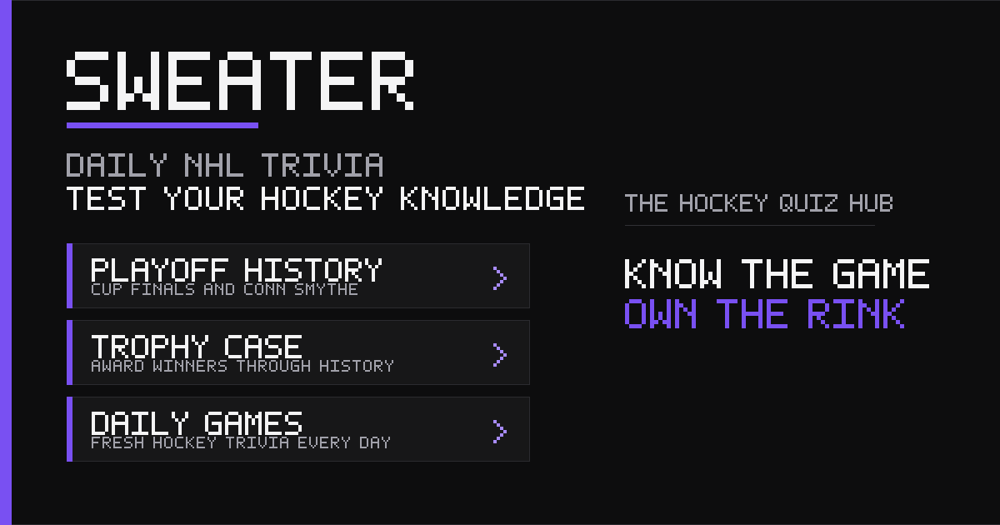

# Sweater

**Daily NHL trivia for hockey fans.**

Sweater brings player guessing, highlight challenges, roster recall, hockey history, and lineup strategy together in one place. Find your favourite mode, build a daily streak, or put your franchise knowledge to the test.

**[Play Sweater →](https://sweater.win/)** · [Explore the games](#games) · [Run locally](#local-development) · [Report an issue](https://github.com/cartsybends/sweater.win/issues)

[](https://sweater.win/)

[](https://github.com/cartsybends/sweater.win/actions/workflows/update.yml)

## Games

| Game | The challenge |
| --- | --- |
| **Classic** | Identify an NHL player using team, position, age, and other clues. |
| **Who Scored?** | Watch a goal with the scorer covered by a silhouette, then name the player. |
| **Roster Recall** | Name as many players from a team's roster as you can in 60 seconds. |
| **Higher or Lower** | Compare player stats and keep your streak alive. |
| **Shootout** | Answer trivia to earn shots, then try to beat the goalie. |
| **Sweater Grid** | Fill nine squares with players who satisfy both intersecting clues. |
| **Bench Boss** | Build the strongest six-player lineup for a specific season within a $100 budget. |
| **Teammate Trail** | Connect two players through their NHL teammates. |

The library also includes player careers, awards, playoff history, and NHL EDGE tracking challenges. Choose a franchise for **Who Am I?**, **Team Journey**, **Best Of**, and team-specific **Higher or Lower**.

## Made for a daily hockey routine

- **A shared daily challenge.** Daily puzzles reset at midnight Eastern, with the same assignments for everyone.
- **More ways to play.** Supported modes offer Unlimited and archive play. Who Scored? features one shared goal per day, with unlimited replays of that clip.
- **Progress that stays with you.** Saved rounds, statistics, streaks, XP, and achievements live in your browser. The Locker brings your progress and leaderboard access together.
- **Built for desktop and mobile.** Responsive layouts, light and dark themes, and an installable web app.

## How it works

The frontend uses HTML, CSS, and JavaScript. A Python builder combines public NHL data, cached records, curated puzzle banks, and game assets into a static site.

The [Update Sweater workflow](.github/workflows/update.yml) refreshes data, builds the site, runs validation, and publishes to GitHub Pages. It runs daily, on relevant pushes to `main`, and on manual dispatch. Daily puzzle assignments are persisted in `schedule.json` so published answers stay stable across builds.

An optional Cloudflare Workers and D1 backend supports global leaderboards, Party Mode, and private analytics. See the [backend documentation](backend/README.md) for configuration and deployment.

## Local development

Use **Python 3.12** for the builder and **Node.js 24** for JavaScript checks, matching CI. The site builder uses the Python standard library; there is no frontend package installation step.

```sh
git clone https://github.com/cartsybends/sweater.win.git
cd sweater.win
python build_sweater.py --quiet --out site/index.html --site-url http://localhost:8000/
python -m http.server 8000 --directory site
```

Open **[localhost:8000](http://localhost:8000/)**. Building requires internet access to NHL endpoints and can take several minutes while data is fetched. Builds update local schedules and data caches as well as generating the site.

Leave `--api-url` unset for a local frontend without the shared backend. To connect an API, pass its base URL with `--api-url`. Edit the source files and rebuild; generated HTML is build output.

### Checks

Run these checks from the repository root:

```sh
node tests/frontend_regressions.cjs
node tests/team_games.cjs
node tests/community_games.mjs
python -B tests/community_games_data.py
```

The [deployment workflow](.github/workflows/update.yml) contains the complete validation sequence. Full media checks also require FFmpeg, including `ffprobe`, and Pillow (`python -m pip install "Pillow>=11,<13"`).

## Deployment

1. Set **Settings → Pages → Source** to **GitHub Actions**.
2. Add repository variables under **Settings → Secrets and variables → Actions → Variables**:

   | Variable | Purpose |
   | --- | --- |
   | `SITE_URL` | Public site address, such as `https://sweater.win/`. |
   | `API_URL` | Optional backend base URL. Leave unset to disable backend features. |

3. Open **Actions → Update Sweater → Run workflow** to build and publish.

The workflow also prepares the lightweight homepage, share pages, and web app assets. Backend deployment is configured separately through the [existing Cloudflare Worker](backend/README.md).

## Repository guide

| Path | Purpose |
| --- | --- |
| [`build_sweater.py`](build_sweater.py) | Site builder, core game logic, and interface templates. |
| [`static/`](static/) | Game modules, artwork, trophy images, and goal clips. |
| [`tools/`](tools/) | Data refresh, puzzle curation, and media validation tools. |
| [`tests/`](tests/) | Gameplay, data, frontend, backend, and media checks. |
| [`backend/`](backend/) | Cloudflare Worker API and deployment configuration. |
| [`analytics/`](analytics/) | Browser-side usage and diagnostic collection. |
| [`schedule.json`](schedule.json) | Persisted daily puzzle assignments. |
| [`team_careers.json`](team_careers.json) | Verified NHL career paths for Team Journey. |

For game-specific data and editing guidance, see [team games](static/team-games/README.md), [Grid, Bench Boss, and Teammate Trail](tools/community_games/README.md), and [Who Scored? curation](tools/who_scored/README.md). Preserve published puzzle IDs and existing daily assignments when expanding datasets.

## Feedback

[Report a bug or suggest an improvement](https://github.com/cartsybends/sweater.win/issues). For bugs, include the game mode, your browser and device, and the steps needed to reproduce the issue.

---

Sweater is a fan-made project and is not affiliated with or endorsed by the NHL or its teams.
